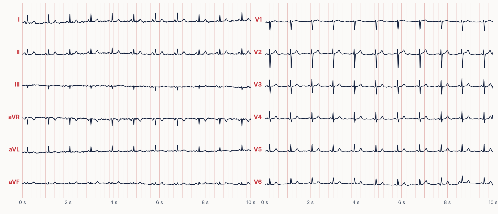
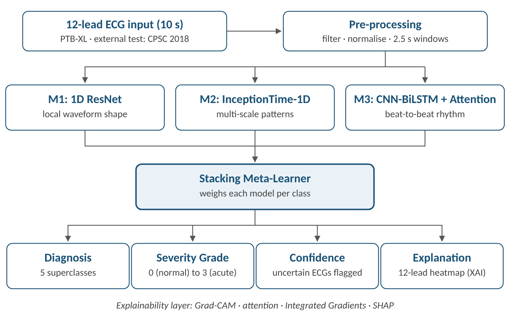
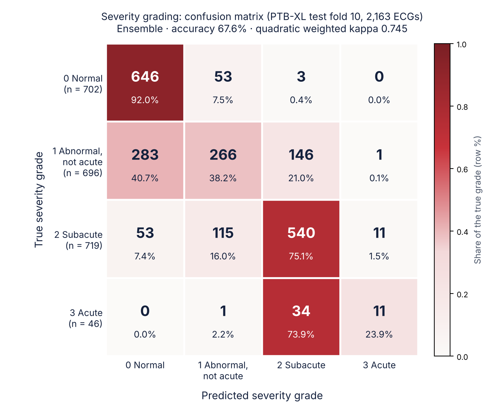
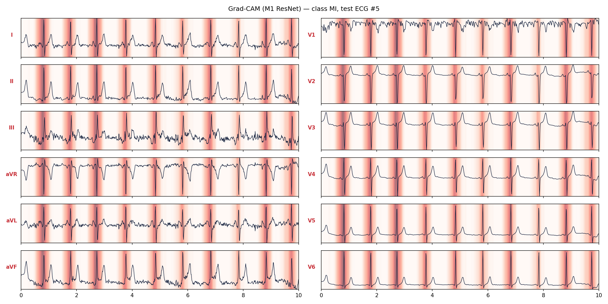
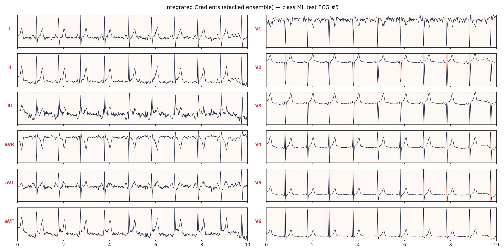
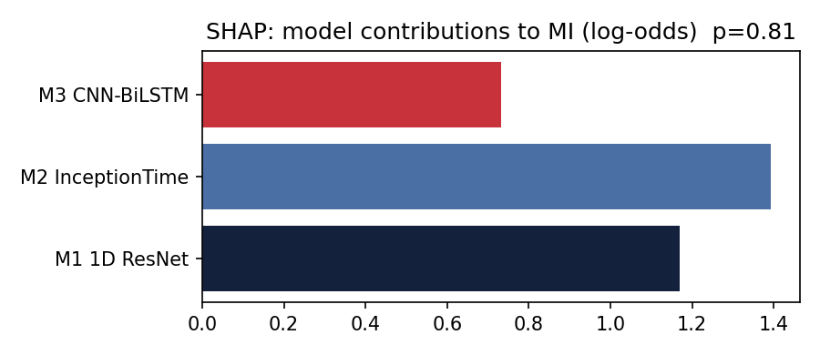

# Explainable ECG Analysis

**Detection and severity grading of cardiovascular abnormalities from 12-lead ECGs, with explanations clinicians can inspect.**

[](https://www.python.org/)
[](https://pytorch.org/)
[](https://ecg-xai-demo-hswicf6nbyixcmpgxmoxbz.streamlit.app/)
[](LICENSE)
[](https://github.com/SworajKhadka/ecg-xai-demo/actions/workflows/tests.yml)

**Live demo:** https://ecg-xai-demo-hswicf6nbyixcmpgxmoxbz.streamlit.app/



---

## Overview

Given a 10-second, 12-lead ECG, the system produces:

- **Diagnosis**: multi-label classification into the five PTB-XL diagnostic superclasses:
  `NORM` (normal ECG), `MI` (myocardial infarction), `STTC` (ST/T change),
  `CD` (conduction disturbance) and `HYP` (hypertrophy).
- **Severity grade** on a 0–3 ordinal scale: 0 Normal, 1 Abnormal (not acute), 2 Subacute, 3 Acute.
- **Confidence**: a score based on how much the three models agree. ECGs below the cut-off are flagged for clinician review.
- **Explanations**: Grad-CAM and Integrated Gradients heatmaps showing *where* in the signal the evidence lies, and SHAP values showing *which model* drove the ensemble's decision.

## How it works



```
PTB-XL (100 Hz)
   │
   ▼
0.5–40 Hz zero-phase Butterworth band-pass  +  per-lead z-score normalisation
   │
   ▼
Three base models on 2.5 s windows (sliding window, 1.25 s stride at test time)
   ├── M1  1D ResNet                   local waveform shape
   ├── M2  InceptionTime               patterns at several time scales
   └── M3  CNN-BiLSTM + attention      beat-to-beat rhythm
   │      each model: 5 diagnostic logits + CORAL ordinal severity head
   ▼
Per-class logistic-regression stacking (meta-learner)
   │
   ▼
Explanations: Grad-CAM · Integrated Gradients · SHAP (exact for the linear meta-learner)
```

All shared code (reading, pre-processing, models, ensemble and explanations) is in [`ecgxai.py`](ecgxai.py). The training notebook and the Streamlit app both import it, so the app behaves exactly like the trained system.

## Dataset

[PTB-XL](https://physionet.org/content/ptb-xl/) (Wagner et al., 2020), from PhysioNet.

- Each ECG has **12 leads × 1000 samples**, which is 10 s at 100 Hz. Voltages are in mV.
- Records are stored in **WFDB** format: a `.hea` text header (leads, gains, sampling rate) and a `.dat` binary signal file.
- Splits use the recommended **patient-wise stratified folds**: folds 1–8 for training, fold 9 for validation, fold 10 for test.

## Results

All results are on the PTB-XL **fold 10 test set (2163 ECGs)**. Source files: [`results.json`](results.json), [`results/ablation.csv`](results/ablation.csv), [`results/severity.csv`](results/severity.csv).

### Diagnosis: ablation

| Method | Macro AUROC | Macro AUPRC | Macro F1 | ECE |
|---|---:|---:|---:|---:|
| M1 1D ResNet | 0.9293 | 0.8292 | 0.7519 | 0.0776 |
| M2 InceptionTime | 0.9302 | 0.8334 | 0.7618 | 0.0678 |
| M3 CNN-BiLSTM | 0.9280 | 0.8251 | 0.7430 | 0.0803 |
| Avg resnet+inception | 0.9337 | 0.8387 | 0.7629 | 0.0712 |
| Avg resnet+bilstm | 0.9326 | 0.8361 | 0.7541 | 0.0785 |
| Avg inception+bilstm | 0.9328 | 0.8363 | 0.7611 | 0.0739 |
| Soft voting (3 models) | 0.9344 | 0.8399 | 0.7614 | 0.0741 |
| **Stacking (ours)** | **0.9345** | **0.8401** | **0.7641** | **0.0272** |

Stacking macro AUROC **95% bootstrap CI: 0.9285 – 0.9400**. Stacking gives the best score on every metric. Its main gain is calibration: ECE falls from 0.0741 with soft voting to 0.0272.

### Diagnosis: per class (stacking)

| Class | AUROC | F1 |
|---|---:|---:|
| NORM | 0.9509 | 0.8706 |
| MI | 0.9362 | 0.7553 |
| STTC | 0.9424 | 0.7845 |
| CD | 0.9302 | 0.7759 |
| HYP | 0.9127 | 0.6342 |

### Severity grading

| Model | QWK | Accuracy | Grade-3 sensitivity |
|---|---:|---:|---:|
| M1 1D ResNet | 0.7507 | 0.6856 | 0.1957 |
| M2 InceptionTime | 0.7438 | 0.6602 | 0.2826 |
| M3 CNN-BiLSTM | 0.7193 | 0.6496 | 0.1957 |
| Ensemble (avg) | 0.7447 | 0.6764 | 0.2391 |

Severity confusion matrix for the ensemble (rows = true grade, columns = predicted grade):

| True \ Pred | 0 | 1 | 2 | 3 | Total |
|---|---:|---:|---:|---:|---:|
| **0** | 646 | 53 | 3 | 0 | 702 |
| **1** | 283 | 266 | 146 | 1 | 696 |
| **2** | 53 | 115 | 540 | 11 | 719 |
| **3** | 0 | 1 | 34 | 11 | 46 |

<p align="center"></p>

### Explanation faithfulness: deletion test

On 30 test ECGs, deleting the **top 10%** of samples ranked by attribution lowers the model's output for the explained class by **0.3419** on average. Deleting a **random 10%** changes it by **−0.0045**. The attributions therefore point at signal the model actually relies on.

### Example explanations (MI)

| Grad-CAM | Integrated Gradients | SHAP |
|---|---|---|
|  |  |  |

## Quick start

```bash
git clone https://github.com/SworajKhadka/ecg-xai-demo.git
cd ecg-xai-demo
python -m venv .venv
source .venv/bin/activate          # Windows: .venv\Scripts\activate
pip install -r requirements.txt
streamlit run app.py
```

Then open http://localhost:8501. `requirements.txt` installs the CPU-only build of PyTorch, so you do not need a GPU.

## Using the app

1. **Choose an ECG** in the sidebar. You can pick one of the bundled PTB-XL sample records, which show the cardiologist's label, or upload the `.hea` and `.dat` files of your own WFDB record. The app accepts 12-lead records at 100 Hz or 500 Hz; 500 Hz records are resampled to 100 Hz.
2. **Read the results**: the diagnosis, severity grade and confidence, the ensemble probability of each class against its decision threshold, and each base model's output.
3. **Choose an explanation method**: Grad-CAM (M1 or M2) or Integrated Gradients (ensemble). Then choose which class to explain. Red areas on the ECG mark the signal that mattered most.
4. **SHAP** shows how much each base model contributed to the ensemble's decision.
5. Expand **Model performance on PTB-XL fold 10** to see the test-set metrics and the severity confusion matrix.

## Training

The models were trained on a Kaggle GPU with the notebook `notebooks/ecg_xai_kaggle.ipynb`. It downloads PTB-XL, trains the three base models, fits the stacking meta-learner on fold 9 and evaluates on fold 10. It writes `models/` (weights and `meta.json`), `results.json` and the figures.

## Evaluate samples

```bash
python scripts/evaluate_samples.py
```

This runs the ensemble on every record in `samples/samples.json`. For each record it prints the true and predicted classes, the severity grade and the confidence, then the number of exact label matches.

## Tests

```bash
pip install -r requirements-dev.txt
pytest
```

The tests cover the WFDB reader, the severity rules, the output shapes of each model and an end-to-end ensemble prediction. GitHub Actions runs them on every push and pull request.

## Project structure

```
ecg-xai-demo/
├── app.py                    Streamlit demo
├── ecgxai.py                 shared code: reading, pre-processing, models, ensemble, explanations
├── results.json              test-set metrics (read by the app)
├── requirements.txt          runtime dependencies (CPU-only PyTorch)
├── requirements-dev.txt      test dependencies
├── models/                   resnet.pt, inception.pt, bilstm.pt, meta.json
├── samples/                  PTB-XL sample records (.hea/.dat) + samples.json labels
├── results/                  ablation.csv, severity.csv
├── docs/figures/             architecture, sample ECG, confusion matrix, explanation figures
├── notebooks/                Kaggle training notebook
├── scripts/                  evaluate_samples.py
├── tests/                    pytest suite
└── .github/workflows/        CI
```

## Limitations

- **Preliminary results.** These numbers come from a single training run and have not been tuned or peer-reviewed.
- **Fold-9 blending.** Fold 9 was used both to fit the stacking meta-learner and to choose the decision thresholds, so it was not held out from model selection.
- **Draft severity mapping.** The 0–3 grades come from rule-based mapping of PTB-XL SCP codes (see `severity_grade` in `ecgxai.py`). A clinician has not yet reviewed the mapping.
- **Low grade-3 sensitivity.** Acute cases (grade 3) are rare: 46 of the 2163 test ECGs. Grade-3 sensitivity is only 0.20–0.28, so most acute cases are under-graded.
- **No external validation yet.** The models have only been evaluated on PTB-XL.

## Team

- Sworaj Khadka
- Sheik Mohammed Suhail
- Gowtham S
- Krishal Karna

**Guide:** Dr. Ravikumar R. Natarajan
Department of Computer Science and Engineering, JAIN (Deemed-to-be University)

## References

1. Wagner, P., Strodthoff, N., Bousseljot, R.-D., et al. (2020). PTB-XL, a large publicly available electrocardiography dataset. *Scientific Data*, 7, 154.
2. Strodthoff, N., Wagner, P., Schaeffter, T., & Samek, W. (2021). Deep learning for ECG analysis: Benchmarks and insights from PTB-XL. *IEEE Journal of Biomedical and Health Informatics*, 25(5), 1519–1528.

## Disclaimer

This is a research decision-support prototype. **It is not a medical device.** It has not been clinically validated and must not be used for diagnosis or treatment decisions.

## License

Released under the [MIT License](LICENSE).
